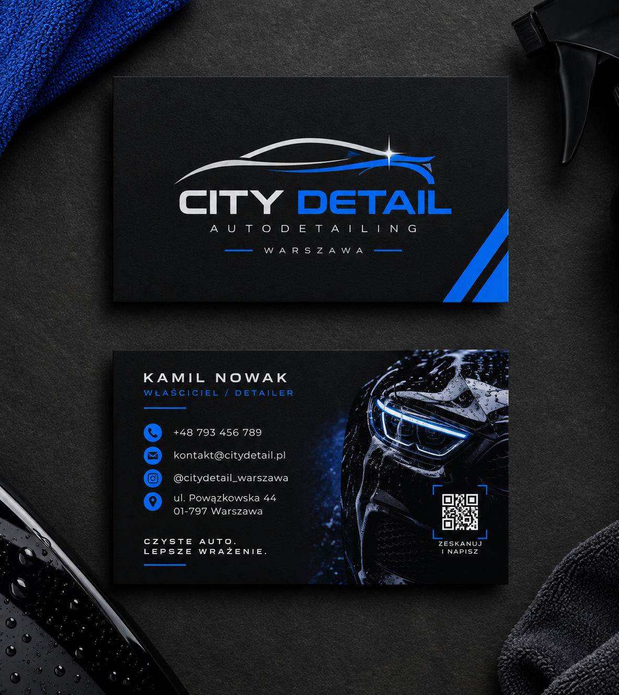
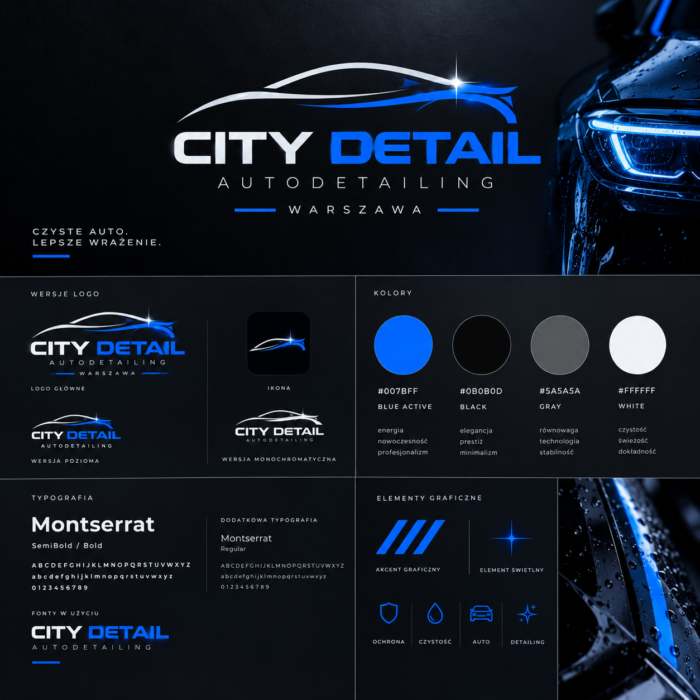
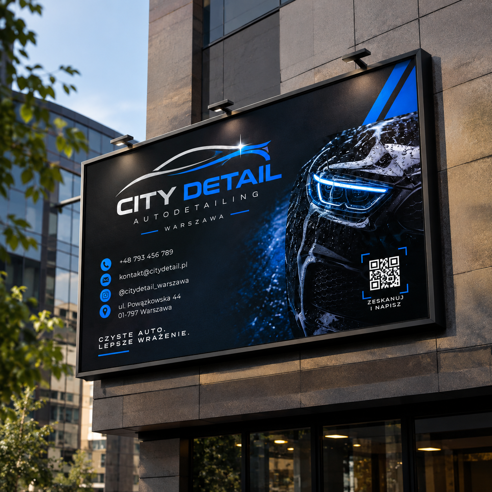

# City Detail — Car Detailing Branding

**Portfolio concept · PANTIK / Pavel Kashyn**

A visual identity concept for City Detail, a car detailing brand. Electric blue accents, dark backgrounds and automotive imagery connect the logo, business cards and outdoor advertising.

## Gallery

## About

Presented as a design concept for portfolio purposes. Brand names, sample contact details and promotional offers shown in the visuals are part of the concepts.

This repository contains image exports. Editable design source files are not included.

[Portfolio](https://pantikdesign.pages.dev/) · [Behance](https://www.behance.net/paveldesigns) · [Contact](https://t.me/pk_designstudio)
